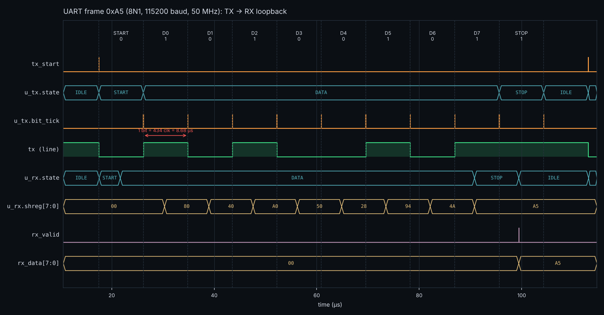
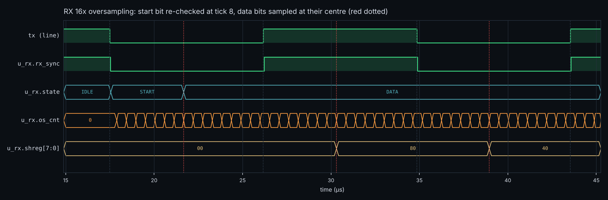
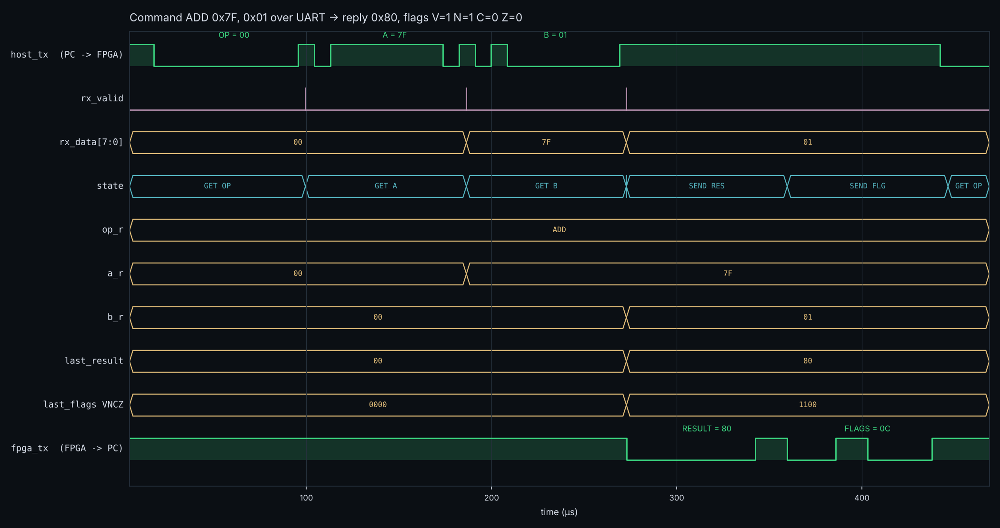

# FPGA UART ALU

An 8-bit ALU controlled over a serial port, written in Verilog for the Terasic DE10-Lite (Intel MAX 10, 50 MHz).
A PC sends a 3-byte command over UART; the FPGA computes the result and sends back the result and status flags.

**Author:** Ish Bedi, B.Eng. Electrical Engineering



## Highlights

- **UART transmitter and receiver from scratch**: 8N1 framing, 115200 baud at 50 MHz, baud rate set by parameter
- **16x oversampling receiver** with a two-flop synchronizer, mid-bit sampling, glitch rejection on the start bit and framing-error detection on the stop bit
- **8-bit ALU** with 8 operations and Zero, Carry, Negative and Overflow flags
- **FSM-based command protocol** tying the UART to the ALU
- **Self-checking testbenches** in Icarus Verilog: an exhaustive ALU test (524,288 vectors), a UART loopback with bit-timing checks, and a full system test that drives serial commands like a PC would
- Waveforms generated straight from the simulation VCD files

## How it works

```
             +-----------------------------------------------------------+
  PC  ---->  | uart_rx --> command FSM --> alu8 --> command FSM --> uart_tx |  ---->  PC
 (USB-serial)|  (16x)      GET_OP/A/B     (comb.)    SEND_RES/FLG   (8N1)    | (USB-serial)
             +-------------------------------+---------------------------+
                                             |
                                 HEX1:HEX0 = result, LEDR = flags
```

### Protocol

| Direction | Bytes | Meaning |
|---|---|---|
| PC to FPGA | `OP`, `A`, `B` | `OP` bits [2:0] pick the operation |
| FPGA to PC | `RESULT`, `FLAGS` | `FLAGS = {4'b0000, V, N, C, Z}` |

### ALU operations

| OP | Name | Result | Carry flag | Overflow flag |
|---|---|---|---|---|
| 0 | ADD | A + B | carry out of bit 7 | signed overflow |
| 1 | SUB | A - B | borrow (A < B) | signed overflow |
| 2 | AND | A & B | 0 | 0 |
| 3 | OR  | A \| B | 0 | 0 |
| 4 | XOR | A ^ B | 0 | 0 |
| 5 | SHL | A << B[2:0] | last bit shifted out | 0 |
| 6 | SHR | A >> B[2:0] | last bit shifted out | 0 |
| 7 | NOT | ~A | 0 | 0 |

Z = result is zero, N = result bit 7.

## Repository layout

| Path | Contents |
|---|---|
| `rtl/baud_gen.v` | Baud tick generator, divider rounded at elaboration |
| `rtl/uart_tx.v` | Transmitter FSM (IDLE, START, DATA, STOP) with shift register |
| `rtl/uart_rx.v` | Receiver FSM with synchronizer, 16x oversampling, framing error |
| `rtl/alu8.v` | Combinational ALU with V/N/C/Z flags |
| `rtl/uart_alu.v` | Command FSM: collects OP/A/B, runs the ALU, sends the reply |
| `rtl/hex7seg.v` | Hex digit to 7-segment (active low) |
| `rtl/de10_lite_top.v` | Board top level: reset synchronizer, pins, LEDs, HEX displays |
| `tb/` | Self-checking testbenches |
| `quartus/` | Quartus Prime Lite project, pin assignments and timing constraints |
| `scripts/plot_waves.py` | Draws the PNGs in `docs/` from the VCD files |

## Verification

Run everything with `make` (needs [Icarus Verilog](https://steveicarus.github.io/iverilog/)):

```
$ make test
tb_alu8: exhaustive check, 8 ops x 256 x 256
PASS: 524288 vectors, 0 mismatches

tb_uart: loopback of 256 bytes at 115200 baud (434 clocks/bit)
  loopback: 257 frames, 0 data errors
  timing:   1159 TX edges checked, 0 off-boundary
  framing:  bad stop bit flagged, byte discarded
  glitch:   1/4-bit low pulse rejected
PASS

tb_uart_alu: commands over UART at 115200 baud
  ADD 7f, 01 -> 80  VNCZ=1100
  ADD ff, 01 -> 00  VNCZ=0011
  SUB 10, 20 -> f0  VNCZ=0110
  ...
PASS: 50 commands, 0 mismatches
```

| Testbench | What it checks |
|---|---|
| `tb_alu8.v` | Every opcode with every pair of operands against a separate reference model |
| `tb_uart.v` | All 256 byte values through TX into RX; every TX edge on an exact bit boundary (434 clocks); frame length; framing error on a low stop bit; a 1/4-bit glitch is ignored |
| `tb_uart_alu.v` | The testbench acts as the PC: serializes commands, decodes replies, checks result, flags and the LED/HEX registers |

Open any waveform in GTKWave with `gtkwave build/tb_uart.vcd`, or redraw the PNGs with `make waves`.

### Receiver sampling

The receiver re-checks the start bit at the middle (tick 8 of 16) and then samples each data bit at its centre.



### Full command

`ADD 0x7F, 0x01` gives `0x80` with the overflow and negative flags set.



## Running on the DE10-Lite

1. Open `quartus/uart_alu.qpf` in Quartus Prime Lite, compile, and program the board.
2. Wire a 3.3 V USB-to-serial adapter: adapter TX to Arduino header **D0**, adapter RX to **D1**, GND to GND.
3. Open the port at 115200 baud, 8N1, and send raw bytes. For example `00 7F 01` returns `80 0C`.
4. **KEY0** resets. HEX1:HEX0 show the last result, LEDR[3:0] the flags, LEDR[9] lights after a framing error.

## Tools

Verilog, Intel Quartus Prime Lite, Icarus Verilog, GTKWave, Python and matplotlib.
